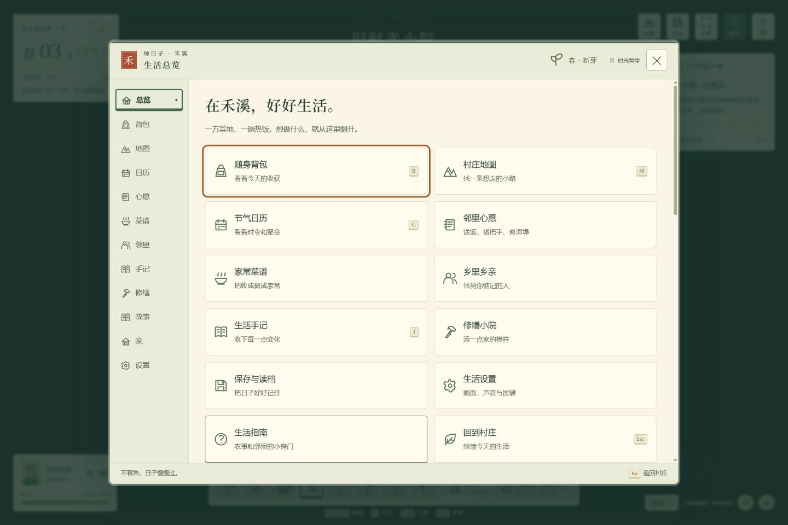
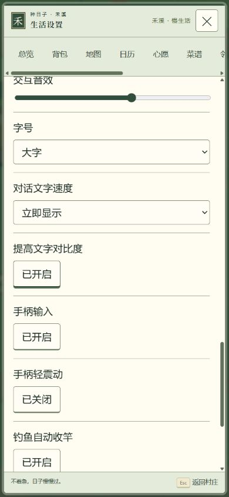

# v0.20 UI 美术资源落实

依据 [UI美术资源优化思路](UI美术资源优化思路.md)，结合现有 Canvas 世界与游戏内生活簿，落实适合当前玩法的视觉组件。方案中的历史环境描述不是本次开发前提；本轮直接检查并修改了现有项目。

## 已落实

| 方案方向 | 游戏内实现 |
| --- | --- |
| 统一乡村手账风格 | 竹纸底、书脊、朱红“禾”印、细边框与统一卡片；背包、经营、农事、建设等共用配色 |
| 主题资源 | 设置 → 手账主题：竹纸手账、青瓷小笺、原木账簿；即时切换并随存档保存 |
| 四季点缀 | 春芽、夏荷、秋谷、冬雪 SVG 边饰；读取实际季节和节庆，可单独关闭 |
| 面板分层 | 宽屏章节侧栏、窄屏横向导航；地图较宽，对话与确认事项使用聚焦面板 |
| 按钮状态 | 主次操作、危险、选中、不可用、悬停、按下、键盘焦点；边框、符号与文字辅助辨认 |
| 字体与数字 | 标题采用衬线层次，正文提高行距，数量使用等宽数字；衔接已有字号和对比度设置 |
| 图标与肖像 | 复用现有图标体系，补齐功能入口小图标、对话肖像边框；始终保留文字名称 |
| 信息密度 | 背包及交易规则可折叠回看，紧凑概览与卡片留白让主要内容更早出现 |
| HUD 与过程反馈 | 日期、工具栏、轻提示和动作进度采用一致材质；动作仍有过程与取消入口 |
| 可访问性 | 设置控件补齐可读标签，折叠说明纳入键盘焦点及现有手柄按钮导航；减少动效选项同步 UI |

## 兼容与资源组织

新增 src/ui-art.js 管理主题、季节装饰、章节和存档偏好，ui-art.css 集中管理视觉变量、组件和响应式布局。资源由代码原生 CSS / SVG 构成，无外部字体下载或图片运行依赖；正式单文件构建已内嵌。

新增 uiArt.theme 与 uiArt.seasonal，旧档默认竹纸手账并开启四季边饰；严格校验偏好，仅改外观，不改背包、关系、时间、金钱与经营规则。全屏世界、游戏内菜单、连续地图和隐藏小地图沿用原设定。

## 验证

- 20 个测试文件、425 项测试全部通过；新增 8 项覆盖旧档、偏好往返、异常输入、存档槽隔离、季节节庆与基础颜色对比度。
- 56 段成品脚本及资源检查通过；正式成品没有外部运行资源和开发验收入口。
- 浏览器实际检查三种主题、刷新恢复、背包、对话、冬季装饰和 390×844 窄屏下的 1.3 倍字号及高对比度。
- 正式 4173 成品读取原有小满存档：春05、180元、87/100体力、41件物品，控制台无错误。
- 键盘焦点和现有手柄导航代码已适配；未使用实体手柄验收。基础配色检查不等同完整无障碍认证。
- 内置浏览器不支持本轮 file:// 实测；已验证 HTTP 下单文件启动及无网络资源依赖。

## 当前边界

三种主题直接可选，本轮没有新增成就解锁主题、完整多语言、独立九宫格位图图集或新奖励系统。继续复用既有交互动作，UI 切换本身采用简短反馈。

## 验收图片

