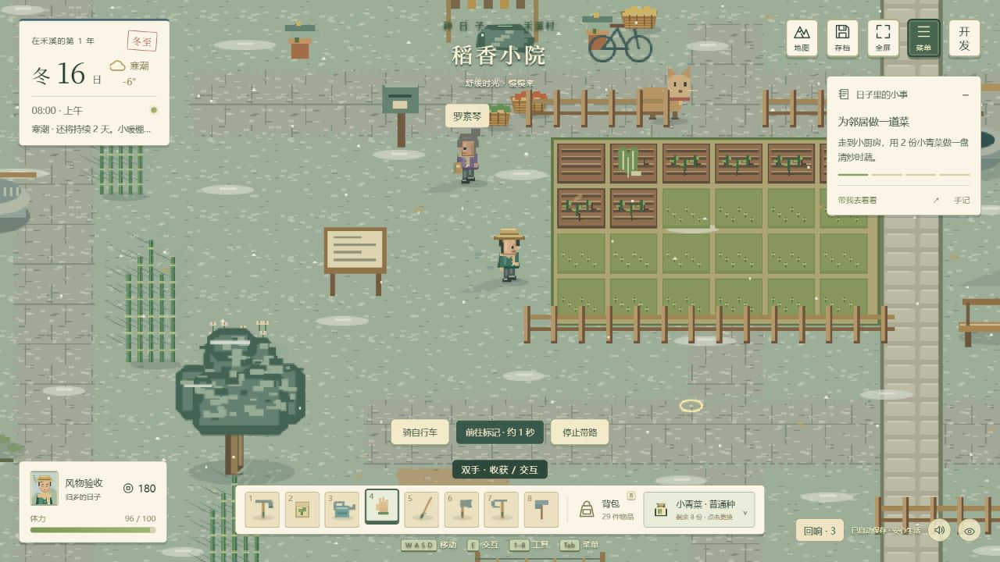

# v0.21 特效与动画资源落实

依据 [特效与动画资源优化思路](特效与动画资源优化思路.md)，对当前游戏的 Canvas 动画、动作队列、真实状态反馈、天气和加工系统逐项检查后实施。原方案关于“工作区没有文件”的历史说明不适用于本轮；本轮已读取并修改实际项目。

## 本轮实现

| 资源 / 场景 | 触发与表现 | 时长、层级与降级 |
| --- | --- | --- |
| 浇水、鱼获 | 完成且确有状态变化时，出现浅青水滴及落地点涟漪 | 1～1.1 秒，世界坐标；降低密度后保留结果标记 |
| 锄地、播种、挖笋、喂食 | 土屑或细小颗粒，以重力轨迹落到地面后停留消退 | 0.8～0.9 秒，每次 5～8 粒 |
| 伐木、建设、交易 | 木色碎屑或轻量交接反馈，保留原工具动作 | 0.8～1.2 秒，每次 4～10 粒 |
| 收获、采集、剪取、整理 | 短叶屑反馈，与现有库存变更和合并飘字衔接 | 0.9～1 秒，每次 4～8 粒 |
| 照料、抚摸、招呼、料理 | 柔和上浮点缀，避免每种操作都爆散 | 0.9～1.4 秒，每次 3～5 粒 |
| 珍品收获 | 只有实际获得珍品时显示“珍”字小框 | 无全屏闪光、无镜头震动，优先保留 |
| 作物生长 | 同一作物真实跨阶段后短暂舒展，初次读档不假装生长 | 0.85 秒；减少动效时直接呈现正确阶段 |
| 成熟作物 | 仅近处低频微光，减少动效下用静态标记 | 不让整块菜园同时闪烁 |
| 湿地 / 雪地足迹 | 室外实际步行达到步距后出现，不原地生成、不骑车生成 | 4 秒消退，最多 18 个，绘在人物下方 |
| 春花、秋叶、夏虫 | 树木附近按季节与天气出现花瓣、落叶或晚间飞虫 | 最多检查 12 处同屏树木；环境关闭时停用 |
| 溪流水纹 | 使用实际地图水域裁剪；河流与池塘采用不同流速 | 固定少量短水纹，摄像机移动时保持世界锚点 |
| 住户炊烟 | 用餐时间且住户实际在家，或厨房正在热加工 | 最多 8 处同屏烟源，受风漂移 |
| 厨房与设备 | 灶台/蒸笼有任务才冒汽、生火；石磨/榨油机有任务才显示短机械运动 | 加工完成停止运行表现，沿用“可收取”标签 |
| 天气 | 雨线增加屋舍遮蔽；雪粒横向漂移连续；轻柔模式减少雨雪数量 | 保留原光照、地表水痕和雪层及真实预警 |
| 声音同步 | 交互声音移到动作中段接触时，室内环境噪声衰减 | 沿用声音总开关和音量，不以声音作为唯一反馈 |

## 统一实现规则

新增 src/visual-fx.js，管理特效目录、瞬时队列、物理轨迹、场景清理、环境层及设置。交互结果沿用 Feedback.finish 的真实差量，仅有体力变化、无操作结果、取消动作或未完成提示时不发出成功粒子。环境动画与结果队列分开，环境粒子不会挤掉操作反馈。

标准结果队列最多 8 组、72 粒；轻量模式最多 18 粒，同类近距结果在 0.18 秒内合并。切换室内外立即清空上一场景的临时效果；离屏效果不绘制。粒子采用 1～3 像素几何、统一低饱和材质色、取整落点与明确的重力落地，不引入外部图片、动画引擎或运行资源。

新增 visualFx 存档偏好，默认 standard / standard / ambient=true。入口：设置 → 风物与回响，可调交互密度、雨雪表现、乡间环境动效。旧存档补默认值，异常字段拒绝加载；临时粒子、足迹和生长过程不进入存档。沿用已有减少动效、快速动作、浮字密度及音量设置；关闭粒子仍保留实际动作、状态标记与结果文字。

## 验证

- 21 个测试文件、438 项测试全部通过；新增 13 项覆盖迁移、设置往返、真实结果/取消、不穿地面、叠加上限、场景清理、足迹、成长、厨房状态、全地区绘制和暂停。
- 实机检查发现新增牧场没有旧水域资源表时会中断绘制，已修复，并将全部六区纳入回归检查。
- 实机完成采摘：背包 27 → 29 件、体力 100 → 98，目标从成熟青菜变为空田；浇水完整过程及后续体力 96 正常。
- 特效三项偏好修改后刷新，轻量 / 轻柔 / 关闭环境设置均恢复；寒潮雪景、行走与设置排版已实机检查。
- 正式 4173 单文件重新加载原有小满存档，春05、180元、87/100体力正常，控制台无错误；没有在正式端口载入测试场景。
- 57 段内嵌脚本编译及资源检查通过，成品没有外部运行资源和开发入口。内置浏览器不支持本轮 file:// 导航，未将 HTTP 验证等同实际断网启动。

## 范围说明

本轮复用已有 NPC、动物、钓鱼及天气动作，不新增灾害规则、掉落物拾取、剧情镜头、积雪清扫玩法或独立逐帧位图图集。声音时机和衰减已接入，未进行设备音质测量；新增效果设有确定的数量上限，但未宣称所有设备达到固定帧率。

