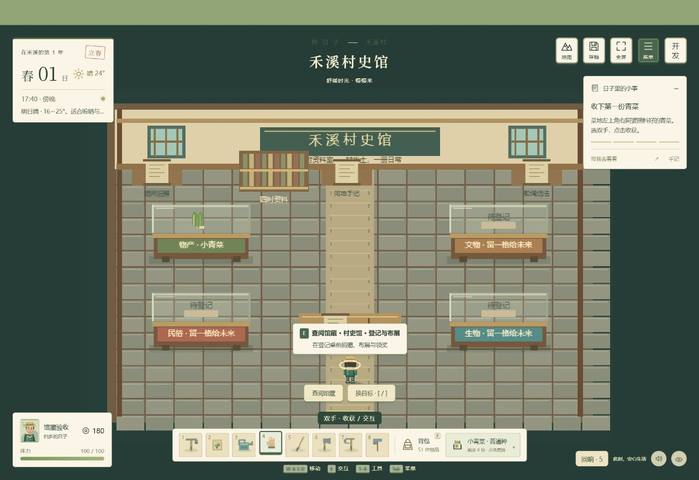
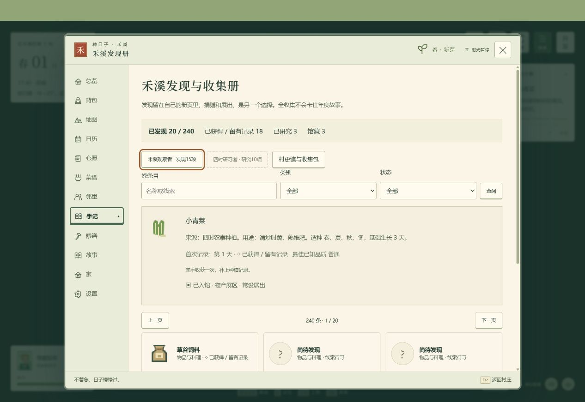

# v0.22 图鉴与收集、村史馆方案落实

日期：2026-09-28。原始建议全文保存在《图鉴与村史馆优化思路.md》，作为产品设计资料阅读；文中“当前工作区没有文件”是提出建议时的背景，不适用于本项目。本轮以实际经营系统和连续村庄为基础落地。

## 已实现的玩法

- **240 个图鉴条目**：190 种物品（含 28 种作物、5 种鱼），5 种家畜、猫狗、3 种野生动物、24 位乡亲、6 个地区、6 件旧物与4种节庆。个人发现、实际获得/留有记录、研究、馆藏登记分别显示。
- 图鉴支持名称/线索检索、类别/状态筛选、分页、未知轮廓、来源和用途、作物时令/生长期、鱼获次数/最大尺寸/水域、已知最佳品质，以及两枚个人纪念章。旧档不能追溯的首次日期明确标注未知，不伪造历史。
- 研究来自已有玩法：亲手收获作物、加工熟练记录、3次鱼获（放流也计）、家畜/宠物亲近、NPC一章故事、跨两天观察白鹭/麻雀/菜粉蝶；普通物品和地区可翻阅资料整理笔记。物品用完后发现记录仍保留。
- 柳岸原有公共晒网屋改建为 **禾溪村史馆**，沿村道到门口、推门进入。保留原房屋标识与旧屋探索记录；没有地区传送或新增常驻小地图。
- **31 类可登记藏品、四类展区**：物产、文物、民俗、生物。实物捐赠明确选择品质并核对扣除1份；锁定物品不可交出。鱼类可以提交鱼获记录，野生动物只登记观察；旧物只交副本，不消耗唯一原件。口述资料要求已听过当事人的故事。
- **5 个常驻主题包**：一方水土、牧场的清晨、把河流还给鱼、家常里的村史、山野有时。奖励为已有庭院布置可用的花圃、长凳、灯笼、茶桌、陶盆。每包只能领取一次；可追踪到游戏内小事卡片并取消，没有截止日期。
- 展馆从旧屋小展开始，经3次布展升级为资料室、水土展厅、共享馆。条件分别为3/7/12类藏品及1/2/3个分类。展柜显示真实常设藏品，新增书架、生态展牌、照明和共读座席；可更换常设展品。资料室展示已取得旧物文字与实际公共工程完成情况。
- 展馆第二阶段修缮后，何青、陆言、江渔、阿婆按轮值与天气/原有日程沿路来访。修正NPC去非自家室内时误用自家门口的问题；出入均经过当前建筑的门。
- 登记、誊写、研究、布展、签收与生态观察接入统一动作序列；完成时才结算，取消保留尚未交出的物品。通知进入手边回响，旧档自动补充收藏状态。

## 操作入口

生活菜单 → 物产图鉴，或生活菜单下方 → 禾溪村史馆。远程可以查阅目录；捐赠、展品调整、升级与领奖需步行到馆内登记桌前。点击展柜也能翻开对应分类。

## 验证与边界

- 455 项自动测试通过，其中新增17项：旧档迁移、发现保留、研究门槛、锁定/品质/距离校验、副本保留、重复提交/领奖、取消不扣物、升级多分类条件、生态观察、损坏存档拒绝、四阶段通路与绘制、NPC真实出入馆、真实收获研究。
- 浏览器隔离验收：步行推门进馆，捐赠小青菜/白萝卜/稻米，取消稻米时仍有7份，实际交接后扣1份；完成“一方水土”、领取花圃并确认按钮禁用；首次修缮出现书架；重新载入保留馆藏和奖励；图鉴鱼类筛选正常。
- 正式成品读取“小满”旧档：春05、180元、82体力、39件物品，图鉴28/240项发现、馆藏0。未使用开发场景覆盖正式档；本次只在正式档查阅。开发与成品控制台检查无游戏运行错误。
- 单文件包含60段内嵌脚本，全部通过语法与资源检查，无远程资源和开发检查台；通过HTTP加载成品。本轮没有再次完成实际断网启动或移动设备真机验收。
- 这是对现有系统的适配：没有强加昆虫捕捉、化石随机掉落、全收集卡主线、限日捐赠或重建全部游戏内容。野生动物扩充为3种可观察对象；常设展品由玩家选择，未实现自由拖拽任意展柜布局。

